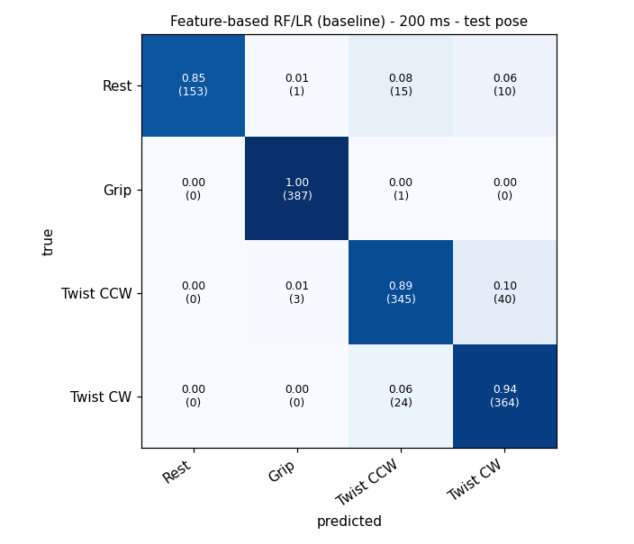
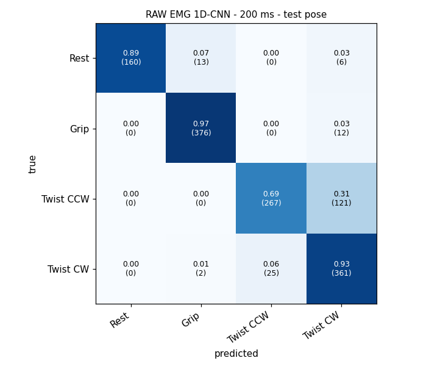
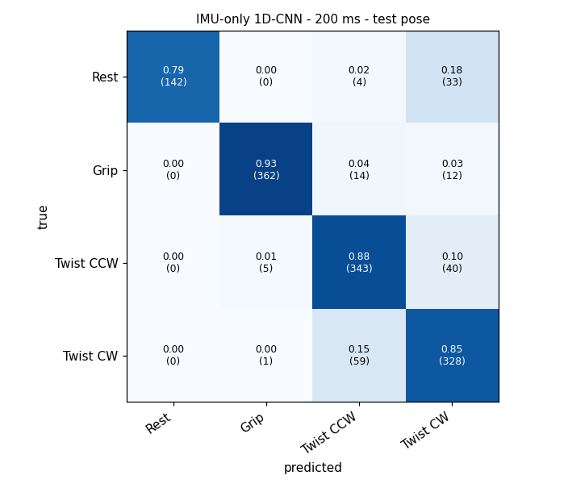
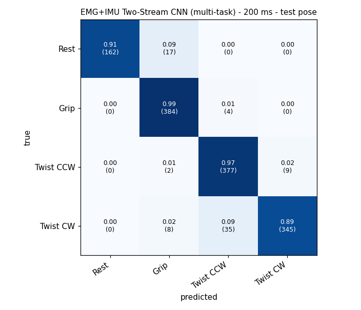
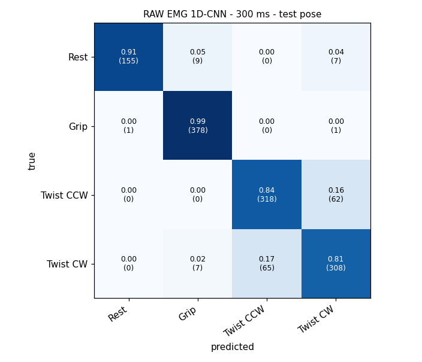
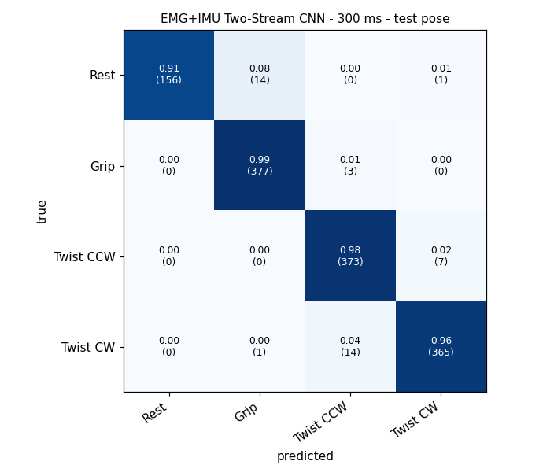
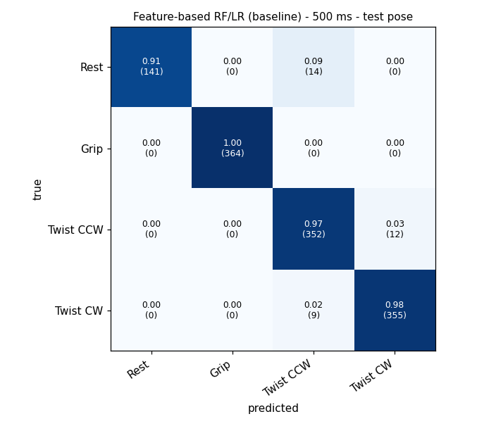
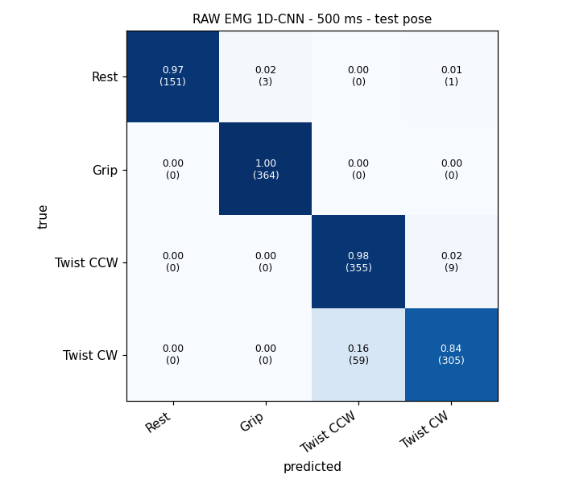
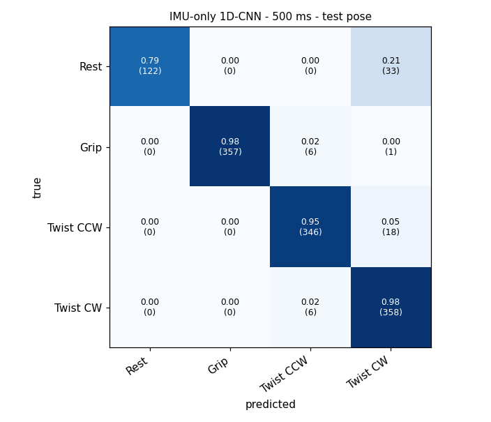
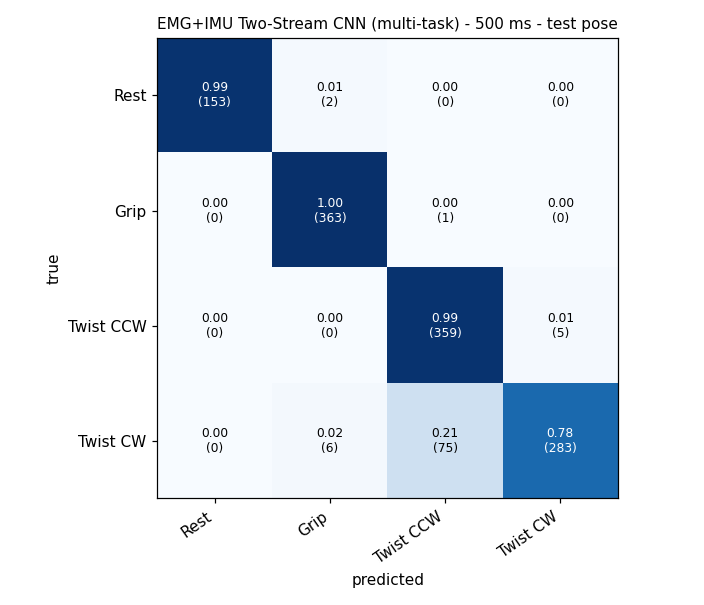

# Pose x Effort model comparison - run legacy_S01_cv

Created 2026-11-11 11:23:39 | elapsed 231 s | torch device cuda

## Data

- S01 / Session_20261103_173516_legacy (IMPORTED_LEGACY_DEVICE): 767 s, lost samples 704, IMU 49.7 Hz

Split mode: **trial**

- trial-independent test: available - test = last trials of every label (temporal hold-out) within each session
- session-independent test: NOT available - 1 session(s) - needs >= 2 sessions; NOT evaluated
- participant-independent test: NOT available - 1 participant(s) - needs >= 2 participants; NOT evaluated
- **Participant-independent evaluation is not possible with data from a single participant.** All numbers below are subject- and session-specific.

## Comparison (test = held-out trials, evaluated once)

| Model | Window | Pose Macro-F1 test (CV) | Effort BA true pose, test (CV) | Effort BA cascade (test) | Effort input | Latency CPU median / p95 | Rest FP raw / smoothed | Switches/s raw / smoothed |
|---|---|---|---|---|---|---|---|---|
| Feature-based RF/LR (baseline) | 200 ms | 0.929 (0.859) | 0.740 (0.805) | 0.730 | emg | 13.66 / 15.02 ms | 0.145 / 0.106 | 1.12 / 0.34 |
| RAW EMG 1D-CNN | 200 ms | 0.877 (0.770) | 0.777 (0.794) | 0.759 | emg | 0.64 / 1.06 ms | 0.106 / 0.101 | 1.59 / 0.86 |
| IMU-only 1D-CNN | 200 ms | 0.878 (0.775) | 0.672 (0.547) | 0.674 | imu | 0.31 / 0.56 ms | 0.207 / 0.201 | 1.34 / 0.71 |
| EMG+IMU Two-Stream CNN | 200 ms | 0.951 (0.837) | 0.772 (0.790) | 0.766 | emg | 0.86 / 1.22 ms | 0.123 / 0.084 | 0.60 / 0.19 |
| EMG+IMU Two-Stream CNN (multi-task) | 200 ms | 0.945 (0.828) | 0.772 (0.780) | 0.766 | emg+imu | 0.42 / 0.72 ms | 0.095 / 0.084 | 0.91 / 0.19 |
| Feature-based RF/LR (baseline) | 300 ms | 0.943 (0.859) | 0.785 (0.823) | 0.777 | emg | 14.91 / 16.82 ms | 0.135 / 0.094 | 0.73 / 0.34 |
| RAW EMG 1D-CNN | 300 ms | 0.893 (0.793) | 0.792 (0.803) | 0.776 | emg | 0.82 / 1.21 ms | 0.094 / 0.088 | 1.65 / 0.75 |
| IMU-only 1D-CNN | 300 ms | 0.916 (0.763) | 0.668 (0.567) | 0.669 | imu | 0.37 / 0.63 ms | 0.129 / 0.117 | 1.07 / 0.52 |
| EMG+IMU Two-Stream CNN | 300 ms | 0.967 (0.848) | 0.782 (0.805) | 0.778 | emg | 0.83 / 1.32 ms | 0.088 / 0.076 | 0.38 / 0.11 |
| EMG+IMU Two-Stream CNN (multi-task) | 300 ms | 0.952 (0.835) | 0.756 (0.792) | 0.751 | emg+imu | 0.50 / 0.82 ms | 0.064 / 0.053 | 0.73 / 0.29 |
| Feature-based RF/LR (baseline) | 500 ms | 0.969 (0.867) | 0.813 (0.851) | 0.812 | emg | 15.35 / 17.05 ms | 0.090 / 0.071 | 0.24 / 0.18 |
| RAW EMG 1D-CNN | 500 ms | 0.948 (0.840) | 0.801 (0.841) | 0.795 | emg | 0.77 / 1.24 ms | 0.026 / 0.006 | 0.88 / 0.24 |
| IMU-only 1D-CNN | 500 ms | 0.939 (0.819) | 0.790 (0.561) | 0.790 | imu | 0.43 / 0.66 ms | 0.213 / 0.168 | 0.53 / 0.21 |
| EMG+IMU Two-Stream CNN | 500 ms | 0.981 (0.872) | 0.807 (0.858) | 0.809 | emg+imu | 1.24 / 1.75 ms | 0.058 / 0.045 | 0.21 / 0.10 |
| EMG+IMU Two-Stream CNN (multi-task) | 500 ms | 0.937 (0.870) | 0.774 (0.807) | 0.771 | emg+imu | 0.54 / 0.89 ms | 0.013 / 0.000 | 0.77 / 0.26 |

**Recommended: Feature-based RF/LR (baseline) @ 500 ms (CV pose F1 0.867, CV effort BA 0.851) (deep model EMG+IMU Two-Stream CNN not better than the baseline by > 0.01; baseline kept)**

Rule: max mean(CV pose macro-F1, CV effort BA with true pose); baseline kept unless a deep model is better by > 0.01; shorter window preferred within 0.01. Test set never used for selection.

Every model predicts every 50 ms (20 Hz) from the most recent window: EMG 8 ch @ 500 Hz (200 ms = 100 samples, 300 ms = 150, 500 ms = 250) and IMU 6 axes @ 50 Hz (10 / 15 / 25 samples).

Latency = window extraction + preprocessing + model on one window, CPU, single thread-ish (not end-to-end; add the stride wait (<= 50 ms), smoothing delay and device/Wi-Fi delay for end-to-end).
Smoothed = causal average of the last 5 window probabilities (adds ~100 ms delay).

## Window 200 ms - details

Pose classes ['Rest', 'Grip', 'Twist CCW', 'Twist CW']; effort poses ['Grip', 'Twist CCW', 'Twist CW']; windows dev 5347 / test 1343; trials dev 56 / test 14; dropped {'invalid': 102, 'reasons': {'IMU': 53, 'EMG': 49}}

Median gyro magnitude by label (dps): {'Grip|High': 8.1, 'Grip|Low': 6.3, 'Rest': 5.2, 'Twist CCW|High': 95.4, 'Twist CCW|Low': 70.2, 'Twist CW|High': 82.7, 'Twist CW|Low': 47.7}

### Feature-based RF/LR (baseline)

Model input (per prediction):

```
예측 1회 = 최근 200 ms 구간 · 50 ms마다 예측 = 20 Hz (연속 예측끼리 150 ms 겹침)
  EMG 8ch @ 500 Hz → 100 샘플/ch (필터: HP 20 Hz + notch 60 Hz)
  IMU 6축 @ 50 Hz → 10 샘플/축 (acc xyz g, gyro xyz °/s)
  Pose: EMG + IMU 사용 → EMG features 32 (RMS, MAV, WL, STD x 8 ch) + IMU features 13 (gyro mean/std x3, |gyro| mean, acc mean/std x3) → Random Forest on log1p + z-scored features
  Effort: EMG 사용 → EMG features 32 (RMS, MAV, WL, STD x 8 ch) → Logistic Regression, one per pose
```

Pose test per-class F1: {'Rest': 0.9217, 'Grip': 0.9936, 'Twist CCW': 0.8926, 'Twist CW': 0.9077}

Effort input chosen: **emg** (CV mean BA per input: emg 0.805, emg+imu 0.809; CV speed-confound rho: emg +0.21, emg+imu +0.38) - emg+imu not better than emg by > 0.01 (CV BA 0.809 vs 0.805)

| effort input | pose | test BA (true pose) | CV BA | test BA cascade |
|---|---|---|---|---|
| emg | Grip | 0.969 | 0.928 | 0.966 |
| emg | Twist CCW | 0.593 | 0.715 | 0.554 |
| emg | Twist CW | 0.657 | 0.772 | 0.670 |
| emg+imu | Grip | 0.972 | 0.920 | 0.969 |
| emg+imu | Twist CCW | 0.639 | 0.662 | 0.611 |
| emg+imu | Twist CW | 0.724 | 0.846 | 0.727 |

Speed confound check (test; Spearman rho of gyro magnitude vs P(High) within an effort level; |rho| > 0.3 means the effort output partly follows movement speed):

- Grip|Low: rho -0.14 (n=194, median |w| 6 dps)
- Grip|High: rho +0.58 (n=194, median |w| 7 dps)
- Twist CCW|Low: rho +0.15 (n=194, median |w| 88 dps)
- Twist CCW|High: rho +0.20 (n=194, median |w| 87 dps)
- Twist CW|Low: rho +0.45 (n=194, median |w| 60 dps)
- Twist CW|High: rho +0.33 (n=194, median |w| 75 dps)

Run-time parity (predictor on re-extracted raw windows vs batch evaluation): max |diff| 8.88e-16 over 150 windows



### RAW EMG 1D-CNN

Model input (per prediction):

```
예측 1회 = 최근 200 ms 구간 · 50 ms마다 예측 = 20 Hz (연속 예측끼리 150 ms 겹침)
  EMG 8ch @ 500 Hz → 100 샘플/ch (필터: HP 20 Hz + notch 60 Hz)
  IMU 6축 @ 50 Hz → 10 샘플/축 (acc xyz g, gyro xyz °/s)
  Pose: EMG 사용 → EMG (8, 100) time series (scaled per channel, no hand-crafted features) → 1D-CNN emg -> pose softmax
  Effort: EMG 사용 → EMG (8, 100) time series (scaled per channel, no hand-crafted features) → 1D-CNN emg -> P(High) per pose
```

Pose test per-class F1: {'Rest': 0.944, 'Grip': 0.9653, 'Twist CCW': 0.7853, 'Twist CW': 0.8131}

Effort input chosen: **emg** (CV mean BA per input: emg 0.794; CV speed-confound rho: emg +0.23) - 

| effort input | pose | test BA (true pose) | CV BA | test BA cascade |
|---|---|---|---|---|
| emg | Grip | 0.972 | 0.970 | 0.972 |
| emg | Twist CCW | 0.590 | 0.618 | 0.552 |
| emg | Twist CW | 0.768 | 0.795 | 0.753 |

Speed confound check (test; Spearman rho of gyro magnitude vs P(High) within an effort level; |rho| > 0.3 means the effort output partly follows movement speed):

- Grip|Low: rho -0.10 (n=194, median |w| 6 dps)
- Grip|High: rho +0.62 (n=194, median |w| 7 dps)
- Twist CCW|Low: rho +0.01 (n=194, median |w| 88 dps)
- Twist CCW|High: rho +0.26 (n=194, median |w| 87 dps)
- Twist CW|Low: rho +0.35 (n=194, median |w| 60 dps)
- Twist CW|High: rho +0.42 (n=194, median |w| 75 dps)

Run-time parity (predictor on re-extracted raw windows vs batch evaluation): max |diff| 3.58e-07 over 150 windows



### IMU-only 1D-CNN

Model input (per prediction):

```
예측 1회 = 최근 200 ms 구간 · 50 ms마다 예측 = 20 Hz (연속 예측끼리 150 ms 겹침)
  EMG 8ch @ 500 Hz → 100 샘플/ch (필터: HP 20 Hz + notch 60 Hz)
  IMU 6축 @ 50 Hz → 10 샘플/축 (acc xyz g, gyro xyz °/s)
  Pose: IMU 사용 → IMU (6, 10) time series (scaled per channel, no hand-crafted features) → 1D-CNN imu -> pose softmax
  Effort: IMU 사용 → IMU (6, 10) time series (scaled per channel, no hand-crafted features) → 1D-CNN imu -> P(High) per pose
```

Pose test per-class F1: {'Rest': 0.8847, 'Grip': 0.9577, 'Twist CCW': 0.849, 'Twist CW': 0.819}

Effort input chosen: **imu** (CV mean BA per input: imu 0.547; CV speed-confound rho: imu +0.33) - only option

| effort input | pose | test BA (true pose) | CV BA | test BA cascade |
|---|---|---|---|---|
| imu | Grip | 0.874 | 0.537 | 0.871 |
| imu | Twist CCW | 0.526 | 0.407 | 0.531 |
| imu | Twist CW | 0.616 | 0.696 | 0.621 |

Speed confound check (test; Spearman rho of gyro magnitude vs P(High) within an effort level; |rho| > 0.3 means the effort output partly follows movement speed):

- Grip|Low: rho +0.24 (n=194, median |w| 6 dps)
- Grip|High: rho -0.28 (n=194, median |w| 7 dps)
- Twist CCW|Low: rho +0.81 (n=194, median |w| 88 dps)
- Twist CCW|High: rho +0.84 (n=194, median |w| 87 dps)
- Twist CW|Low: rho +0.91 (n=194, median |w| 60 dps)
- Twist CW|High: rho +0.86 (n=194, median |w| 75 dps)

Run-time parity (predictor on re-extracted raw windows vs batch evaluation): max |diff| 5.96e-07 over 150 windows



### EMG+IMU Two-Stream CNN

Model input (per prediction):

```
예측 1회 = 최근 200 ms 구간 · 50 ms마다 예측 = 20 Hz (연속 예측끼리 150 ms 겹침)
  EMG 8ch @ 500 Hz → 100 샘플/ch (필터: HP 20 Hz + notch 60 Hz)
  IMU 6축 @ 50 Hz → 10 샘플/축 (acc xyz g, gyro xyz °/s)
  Pose: EMG + IMU 사용 → EMG (8, 100) + IMU (6, 10) time series (scaled per channel, no hand-crafted features) → 1D-CNN emg+imu -> pose softmax
  Effort: EMG 사용 → EMG (8, 100) time series (scaled per channel, no hand-crafted features) → 1D-CNN emg -> P(High) per pose
```

Pose test per-class F1: {'Rest': 0.9345, 'Grip': 0.9771, 'Twist CCW': 0.9465, 'Twist CW': 0.946}

Effort input chosen: **emg** (CV mean BA per input: emg 0.790, emg+imu 0.789; CV speed-confound rho: emg +0.25, emg+imu +0.29) - emg+imu not better than emg by > 0.01 (CV BA 0.789 vs 0.790)

| effort input | pose | test BA (true pose) | CV BA | test BA cascade |
|---|---|---|---|---|
| emg | Grip | 0.972 | 0.969 | 0.961 |
| emg | Twist CCW | 0.580 | 0.621 | 0.564 |
| emg | Twist CW | 0.765 | 0.780 | 0.773 |
| emg+imu | Grip | 0.964 | 0.954 | 0.956 |
| emg+imu | Twist CCW | 0.644 | 0.571 | 0.629 |
| emg+imu | Twist CW | 0.796 | 0.842 | 0.807 |

Speed confound check (test; Spearman rho of gyro magnitude vs P(High) within an effort level; |rho| > 0.3 means the effort output partly follows movement speed):

- Grip|Low: rho -0.11 (n=194, median |w| 6 dps)
- Grip|High: rho +0.62 (n=194, median |w| 7 dps)
- Twist CCW|Low: rho +0.03 (n=194, median |w| 88 dps)
- Twist CCW|High: rho +0.29 (n=194, median |w| 87 dps)
- Twist CW|Low: rho +0.36 (n=194, median |w| 60 dps)
- Twist CW|High: rho +0.42 (n=194, median |w| 75 dps)

Run-time parity (predictor on re-extracted raw windows vs batch evaluation): max |diff| 4.17e-07 over 150 windows


### EMG+IMU Two-Stream CNN (multi-task)

Model input (per prediction):

```
예측 1회 = 최근 200 ms 구간 · 50 ms마다 예측 = 20 Hz (연속 예측끼리 150 ms 겹침)
  EMG 8ch @ 500 Hz → 100 샘플/ch (필터: HP 20 Hz + notch 60 Hz)
  IMU 6축 @ 50 Hz → 10 샘플/축 (acc xyz g, gyro xyz °/s)
  Pose: EMG + IMU 사용 → EMG (8, 100) + IMU (6, 10) time series (scaled per channel, no hand-crafted features) → 1D-CNN emg+imu -> pose softmax
  Effort: EMG + IMU 사용 → EMG (8, 100) + IMU (6, 10) time series (scaled per channel, no hand-crafted features) → 1D-CNN emg+imu -> P(High) per pose (shared encoder, multi-task)
```

Pose test per-class F1: {'Rest': 0.9501, 'Grip': 0.9612, 'Twist CCW': 0.9378, 'Twist CW': 0.9299}

Effort input chosen: **emg+imu** (CV mean BA per input: emg+imu 0.780; CV speed-confound rho: emg+imu +0.20) - only option

| effort input | pose | test BA (true pose) | CV BA | test BA cascade |
|---|---|---|---|---|
| emg+imu | Grip | 0.979 | 0.950 | 0.969 |
| emg+imu | Twist CCW | 0.634 | 0.530 | 0.634 |
| emg+imu | Twist CW | 0.704 | 0.860 | 0.696 |

Speed confound check (test; Spearman rho of gyro magnitude vs P(High) within an effort level; |rho| > 0.3 means the effort output partly follows movement speed):

- Grip|Low: rho -0.07 (n=194, median |w| 6 dps)
- Grip|High: rho +0.53 (n=194, median |w| 7 dps)
- Twist CCW|Low: rho +0.39 (n=194, median |w| 88 dps)
- Twist CCW|High: rho +0.65 (n=194, median |w| 87 dps)
- Twist CW|Low: rho +0.67 (n=194, median |w| 60 dps)
- Twist CW|High: rho +0.48 (n=194, median |w| 75 dps)

Run-time parity (predictor on re-extracted raw windows vs batch evaluation): max |diff| 2.98e-07 over 150 windows



## Window 300 ms - details

Pose classes ['Rest', 'Grip', 'Twist CCW', 'Twist CW']; effort poses ['Grip', 'Twist CCW', 'Twist CW']; windows dev 5231 / test 1311; trials dev 56 / test 14; dropped {'invalid': 110, 'reasons': {'IMU': 58, 'EMG': 52}}

Median gyro magnitude by label (dps): {'Grip|High': 8.1, 'Grip|Low': 6.3, 'Rest': 5.2, 'Twist CCW|High': 98.2, 'Twist CCW|Low': 75.5, 'Twist CW|High': 83.0, 'Twist CW|Low': 49.4}

### Feature-based RF/LR (baseline)

Model input (per prediction):

```
예측 1회 = 최근 300 ms 구간 · 50 ms마다 예측 = 20 Hz (연속 예측끼리 250 ms 겹침)
  EMG 8ch @ 500 Hz → 150 샘플/ch (필터: HP 20 Hz + notch 60 Hz)
  IMU 6축 @ 50 Hz → 15 샘플/축 (acc xyz g, gyro xyz °/s)
  Pose: EMG + IMU 사용 → EMG features 32 (RMS, MAV, WL, STD x 8 ch) + IMU features 13 (gyro mean/std x3, |gyro| mean, acc mean/std x3) → Random Forest on log1p + z-scored features
  Effort: EMG 사용 → EMG features 32 (RMS, MAV, WL, STD x 8 ch) → Logistic Regression, one per pose
```

Pose test per-class F1: {'Rest': 0.9279, 'Grip': 0.9948, 'Twist CCW': 0.9174, 'Twist CW': 0.9306}

Effort input chosen: **emg** (CV mean BA per input: emg 0.823, emg+imu 0.833; CV speed-confound rho: emg +0.25, emg+imu +0.42) - emg+imu not better than emg by > 0.01 (CV BA 0.833 vs 0.823)

| effort input | pose | test BA (true pose) | CV BA | test BA cascade |
|---|---|---|---|---|
| emg | Grip | 0.984 | 0.938 | 0.982 |
| emg | Twist CCW | 0.682 | 0.740 | 0.645 |
| emg | Twist CW | 0.689 | 0.792 | 0.705 |
| emg+imu | Grip | 0.984 | 0.926 | 0.982 |
| emg+imu | Twist CCW | 0.676 | 0.694 | 0.650 |
| emg+imu | Twist CW | 0.734 | 0.878 | 0.747 |

Speed confound check (test; Spearman rho of gyro magnitude vs P(High) within an effort level; |rho| > 0.3 means the effort output partly follows movement speed):

- Grip|Low: rho -0.11 (n=190, median |w| 6 dps)
- Grip|High: rho +0.60 (n=190, median |w| 7 dps)
- Twist CCW|Low: rho +0.49 (n=190, median |w| 89 dps)
- Twist CCW|High: rho +0.34 (n=190, median |w| 97 dps)
- Twist CW|Low: rho +0.49 (n=190, median |w| 61 dps)
- Twist CW|High: rho +0.29 (n=190, median |w| 76 dps)

Run-time parity (predictor on re-extracted raw windows vs batch evaluation): max |diff| 3.11e-15 over 150 windows


### RAW EMG 1D-CNN

Model input (per prediction):

```
예측 1회 = 최근 300 ms 구간 · 50 ms마다 예측 = 20 Hz (연속 예측끼리 250 ms 겹침)
  EMG 8ch @ 500 Hz → 150 샘플/ch (필터: HP 20 Hz + notch 60 Hz)
  IMU 6축 @ 50 Hz → 15 샘플/축 (acc xyz g, gyro xyz °/s)
  Pose: EMG 사용 → EMG (8, 150) time series (scaled per channel, no hand-crafted features) → 1D-CNN emg -> pose softmax
  Effort: EMG 사용 → EMG (8, 150) time series (scaled per channel, no hand-crafted features) → 1D-CNN emg -> P(High) per pose
```

Pose test per-class F1: {'Rest': 0.948, 'Grip': 0.9767, 'Twist CCW': 0.8336, 'Twist CW': 0.8127}

Effort input chosen: **emg** (CV mean BA per input: emg 0.803; CV speed-confound rho: emg +0.24) - 

| effort input | pose | test BA (true pose) | CV BA | test BA cascade |
|---|---|---|---|---|
| emg | Grip | 0.955 | 0.982 | 0.953 |
| emg | Twist CCW | 0.632 | 0.627 | 0.618 |
| emg | Twist CW | 0.789 | 0.799 | 0.758 |

Speed confound check (test; Spearman rho of gyro magnitude vs P(High) within an effort level; |rho| > 0.3 means the effort output partly follows movement speed):

- Grip|Low: rho -0.15 (n=190, median |w| 6 dps)
- Grip|High: rho +0.65 (n=190, median |w| 7 dps)
- Twist CCW|Low: rho +0.01 (n=190, median |w| 89 dps)
- Twist CCW|High: rho +0.27 (n=190, median |w| 97 dps)
- Twist CW|Low: rho +0.49 (n=190, median |w| 61 dps)
- Twist CW|High: rho +0.42 (n=190, median |w| 76 dps)

Run-time parity (predictor on re-extracted raw windows vs batch evaluation): max |diff| 5.07e-07 over 150 windows



### IMU-only 1D-CNN

Model input (per prediction):

```
예측 1회 = 최근 300 ms 구간 · 50 ms마다 예측 = 20 Hz (연속 예측끼리 250 ms 겹침)
  EMG 8ch @ 500 Hz → 150 샘플/ch (필터: HP 20 Hz + notch 60 Hz)
  IMU 6축 @ 50 Hz → 15 샘플/축 (acc xyz g, gyro xyz °/s)
  Pose: IMU 사용 → IMU (6, 15) time series (scaled per channel, no hand-crafted features) → 1D-CNN imu -> pose softmax
  Effort: IMU 사용 → IMU (6, 15) time series (scaled per channel, no hand-crafted features) → 1D-CNN imu -> P(High) per pose
```

Pose test per-class F1: {'Rest': 0.9312, 'Grip': 0.9749, 'Twist CCW': 0.87, 'Twist CW': 0.888}

Effort input chosen: **imu** (CV mean BA per input: imu 0.567; CV speed-confound rho: imu +0.33) - only option

| effort input | pose | test BA (true pose) | CV BA | test BA cascade |
|---|---|---|---|---|
| imu | Grip | 0.884 | 0.542 | 0.887 |
| imu | Twist CCW | 0.521 | 0.444 | 0.521 |
| imu | Twist CW | 0.597 | 0.715 | 0.600 |

Speed confound check (test; Spearman rho of gyro magnitude vs P(High) within an effort level; |rho| > 0.3 means the effort output partly follows movement speed):

- Grip|Low: rho +0.21 (n=190, median |w| 6 dps)
- Grip|High: rho -0.29 (n=190, median |w| 7 dps)
- Twist CCW|Low: rho +0.80 (n=190, median |w| 89 dps)
- Twist CCW|High: rho +0.78 (n=190, median |w| 97 dps)
- Twist CW|Low: rho +0.86 (n=190, median |w| 61 dps)
- Twist CW|High: rho +0.70 (n=190, median |w| 76 dps)

Run-time parity (predictor on re-extracted raw windows vs batch evaluation): max |diff| 2.38e-07 over 150 windows


### EMG+IMU Two-Stream CNN

Model input (per prediction):

```
예측 1회 = 최근 300 ms 구간 · 50 ms마다 예측 = 20 Hz (연속 예측끼리 250 ms 겹침)
  EMG 8ch @ 500 Hz → 150 샘플/ch (필터: HP 20 Hz + notch 60 Hz)
  IMU 6축 @ 50 Hz → 15 샘플/축 (acc xyz g, gyro xyz °/s)
  Pose: EMG + IMU 사용 → EMG (8, 150) + IMU (6, 15) time series (scaled per channel, no hand-crafted features) → 1D-CNN emg+imu -> pose softmax
  Effort: EMG 사용 → EMG (8, 150) time series (scaled per channel, no hand-crafted features) → 1D-CNN emg -> P(High) per pose
```

Pose test per-class F1: {'Rest': 0.9541, 'Grip': 0.9767, 'Twist CCW': 0.9688, 'Twist CW': 0.9695}

Effort input chosen: **emg** (CV mean BA per input: emg 0.805, emg+imu 0.805; CV speed-confound rho: emg +0.24, emg+imu +0.28) - emg+imu not better than emg by > 0.01 (CV BA 0.805 vs 0.805)

| effort input | pose | test BA (true pose) | CV BA | test BA cascade |
|---|---|---|---|---|
| emg | Grip | 0.961 | 0.981 | 0.953 |
| emg | Twist CCW | 0.597 | 0.635 | 0.589 |
| emg | Twist CW | 0.789 | 0.800 | 0.792 |
| emg+imu | Grip | 0.963 | 0.962 | 0.963 |
| emg+imu | Twist CCW | 0.658 | 0.601 | 0.653 |
| emg+imu | Twist CW | 0.811 | 0.852 | 0.818 |

Speed confound check (test; Spearman rho of gyro magnitude vs P(High) within an effort level; |rho| > 0.3 means the effort output partly follows movement speed):

- Grip|Low: rho -0.15 (n=190, median |w| 6 dps)
- Grip|High: rho +0.64 (n=190, median |w| 7 dps)
- Twist CCW|Low: rho -0.10 (n=190, median |w| 89 dps)
- Twist CCW|High: rho +0.12 (n=190, median |w| 97 dps)
- Twist CW|Low: rho +0.43 (n=190, median |w| 61 dps)
- Twist CW|High: rho +0.39 (n=190, median |w| 76 dps)

Run-time parity (predictor on re-extracted raw windows vs batch evaluation): max |diff| 5.96e-07 over 150 windows



### EMG+IMU Two-Stream CNN (multi-task)

Model input (per prediction):

```
예측 1회 = 최근 300 ms 구간 · 50 ms마다 예측 = 20 Hz (연속 예측끼리 250 ms 겹침)
  EMG 8ch @ 500 Hz → 150 샘플/ch (필터: HP 20 Hz + notch 60 Hz)
  IMU 6축 @ 50 Hz → 15 샘플/축 (acc xyz g, gyro xyz °/s)
  Pose: EMG + IMU 사용 → EMG (8, 150) + IMU (6, 15) time series (scaled per channel, no hand-crafted features) → 1D-CNN emg+imu -> pose softmax
  Effort: EMG + IMU 사용 → EMG (8, 150) + IMU (6, 15) time series (scaled per channel, no hand-crafted features) → 1D-CNN emg+imu -> P(High) per pose (shared encoder, multi-task)
```

Pose test per-class F1: {'Rest': 0.9668, 'Grip': 0.9716, 'Twist CCW': 0.9379, 'Twist CW': 0.9311}

Effort input chosen: **emg+imu** (CV mean BA per input: emg+imu 0.792; CV speed-confound rho: emg+imu +0.25) - only option

| effort input | pose | test BA (true pose) | CV BA | test BA cascade |
|---|---|---|---|---|
| emg+imu | Grip | 0.958 | 0.933 | 0.950 |
| emg+imu | Twist CCW | 0.666 | 0.579 | 0.658 |
| emg+imu | Twist CW | 0.645 | 0.863 | 0.645 |

Speed confound check (test; Spearman rho of gyro magnitude vs P(High) within an effort level; |rho| > 0.3 means the effort output partly follows movement speed):

- Grip|Low: rho -0.10 (n=190, median |w| 6 dps)
- Grip|High: rho +0.55 (n=190, median |w| 7 dps)
- Twist CCW|Low: rho +0.55 (n=190, median |w| 89 dps)
- Twist CCW|High: rho +0.61 (n=190, median |w| 97 dps)
- Twist CW|Low: rho +0.50 (n=190, median |w| 61 dps)
- Twist CW|High: rho +0.30 (n=190, median |w| 76 dps)

Run-time parity (predictor on re-extracted raw windows vs batch evaluation): max |diff| 2.98e-07 over 150 windows


## Window 500 ms - details

Pose classes ['Rest', 'Grip', 'Twist CCW', 'Twist CW']; effort poses ['Grip', 'Twist CCW', 'Twist CW']; windows dev 5002 / test 1247; trials dev 56 / test 14; dropped {'invalid': 123, 'reasons': {'IMU': 77, 'EMG': 46}}

Median gyro magnitude by label (dps): {'Grip|High': 8.0, 'Grip|Low': 6.2, 'Rest': 5.2, 'Twist CCW|High': 99.7, 'Twist CCW|Low': 77.8, 'Twist CW|High': 83.4, 'Twist CW|Low': 50.0}

### Feature-based RF/LR (baseline)

Model input (per prediction):

```
예측 1회 = 최근 500 ms 구간 · 50 ms마다 예측 = 20 Hz (연속 예측끼리 450 ms 겹침)
  EMG 8ch @ 500 Hz → 250 샘플/ch (필터: HP 20 Hz + notch 60 Hz)
  IMU 6축 @ 50 Hz → 25 샘플/축 (acc xyz g, gyro xyz °/s)
  Pose: EMG + IMU 사용 → EMG features 32 (RMS, MAV, WL, STD x 8 ch) + IMU features 13 (gyro mean/std x3, |gyro| mean, acc mean/std x3) → Random Forest on log1p + z-scored features
  Effort: EMG 사용 → EMG features 32 (RMS, MAV, WL, STD x 8 ch) → Logistic Regression, one per pose
```

Pose test per-class F1: {'Rest': 0.9527, 'Grip': 1.0, 'Twist CCW': 0.9526, 'Twist CW': 0.9713}

Effort input chosen: **emg** (CV mean BA per input: emg 0.851, emg+imu 0.862; CV speed-confound rho: emg +0.29, emg+imu +0.47) - emg+imu rejected: higher CV BA (0.862 vs 0.851) but speed confound rho +0.47 vs +0.29 (follows movement speed)

| effort input | pose | test BA (true pose) | CV BA | test BA cascade |
|---|---|---|---|---|
| emg | Grip | 0.992 | 0.946 | 0.992 |
| emg | Twist CCW | 0.739 | 0.791 | 0.720 |
| emg | Twist CW | 0.709 | 0.817 | 0.725 |
| emg+imu | Grip | 0.992 | 0.940 | 0.992 |
| emg+imu | Twist CCW | 0.723 | 0.737 | 0.706 |
| emg+imu | Twist CW | 0.742 | 0.909 | 0.745 |

Speed confound check (test; Spearman rho of gyro magnitude vs P(High) within an effort level; |rho| > 0.3 means the effort output partly follows movement speed):

- Grip|Low: rho -0.02 (n=182, median |w| 6 dps)
- Grip|High: rho +0.65 (n=182, median |w| 7 dps)
- Twist CCW|Low: rho +0.76 (n=182, median |w| 89 dps)
- Twist CCW|High: rho +0.42 (n=182, median |w| 94 dps)
- Twist CW|Low: rho +0.53 (n=182, median |w| 63 dps)
- Twist CW|High: rho +0.10 (n=182, median |w| 76 dps)

Run-time parity (predictor on re-extracted raw windows vs batch evaluation): max |diff| 5.55e-16 over 150 windows



### RAW EMG 1D-CNN

Model input (per prediction):

```
예측 1회 = 최근 500 ms 구간 · 50 ms마다 예측 = 20 Hz (연속 예측끼리 450 ms 겹침)
  EMG 8ch @ 500 Hz → 250 샘플/ch (필터: HP 20 Hz + notch 60 Hz)
  IMU 6축 @ 50 Hz → 25 샘플/축 (acc xyz g, gyro xyz °/s)
  Pose: EMG 사용 → EMG (8, 250) time series (scaled per channel, no hand-crafted features) → 1D-CNN emg -> pose softmax
  Effort: EMG 사용 → EMG (8, 250) time series (scaled per channel, no hand-crafted features) → 1D-CNN emg -> P(High) per pose
```

Pose test per-class F1: {'Rest': 0.9869, 'Grip': 0.9959, 'Twist CCW': 0.9126, 'Twist CW': 0.8984}

Effort input chosen: **emg** (CV mean BA per input: emg 0.841; CV speed-confound rho: emg +0.22) - 

| effort input | pose | test BA (true pose) | CV BA | test BA cascade |
|---|---|---|---|---|
| emg | Grip | 0.967 | 0.942 | 0.967 |
| emg | Twist CCW | 0.618 | 0.750 | 0.621 |
| emg | Twist CW | 0.819 | 0.830 | 0.797 |

Speed confound check (test; Spearman rho of gyro magnitude vs P(High) within an effort level; |rho| > 0.3 means the effort output partly follows movement speed):

- Grip|Low: rho -0.17 (n=182, median |w| 6 dps)
- Grip|High: rho +0.72 (n=182, median |w| 7 dps)
- Twist CCW|Low: rho +0.24 (n=182, median |w| 89 dps)
- Twist CCW|High: rho +0.21 (n=182, median |w| 94 dps)
- Twist CW|Low: rho +0.57 (n=182, median |w| 63 dps)
- Twist CW|High: rho +0.53 (n=182, median |w| 76 dps)

Run-time parity (predictor on re-extracted raw windows vs batch evaluation): max |diff| 5.36e-07 over 150 windows



### IMU-only 1D-CNN

Model input (per prediction):

```
예측 1회 = 최근 500 ms 구간 · 50 ms마다 예측 = 20 Hz (연속 예측끼리 450 ms 겹침)
  EMG 8ch @ 500 Hz → 250 샘플/ch (필터: HP 20 Hz + notch 60 Hz)
  IMU 6축 @ 50 Hz → 25 샘플/축 (acc xyz g, gyro xyz °/s)
  Pose: IMU 사용 → IMU (6, 25) time series (scaled per channel, no hand-crafted features) → 1D-CNN imu -> pose softmax
  Effort: IMU 사용 → IMU (6, 25) time series (scaled per channel, no hand-crafted features) → 1D-CNN imu -> P(High) per pose
```

Pose test per-class F1: {'Rest': 0.8809, 'Grip': 0.9903, 'Twist CCW': 0.9584, 'Twist CW': 0.9251}

Effort input chosen: **imu** (CV mean BA per input: imu 0.561; CV speed-confound rho: imu +0.32) - only option

| effort input | pose | test BA (true pose) | CV BA | test BA cascade |
|---|---|---|---|---|
| imu | Grip | 0.981 | 0.517 | 0.981 |
| imu | Twist CCW | 0.758 | 0.484 | 0.758 |
| imu | Twist CW | 0.632 | 0.681 | 0.632 |

Speed confound check (test; Spearman rho of gyro magnitude vs P(High) within an effort level; |rho| > 0.3 means the effort output partly follows movement speed):

- Grip|Low: rho +0.09 (n=182, median |w| 6 dps)
- Grip|High: rho -0.32 (n=182, median |w| 7 dps)
- Twist CCW|Low: rho +0.75 (n=182, median |w| 89 dps)
- Twist CCW|High: rho +0.49 (n=182, median |w| 94 dps)
- Twist CW|Low: rho +0.88 (n=182, median |w| 63 dps)
- Twist CW|High: rho +0.70 (n=182, median |w| 76 dps)

Run-time parity (predictor on re-extracted raw windows vs batch evaluation): max |diff| 4.17e-07 over 150 windows



### EMG+IMU Two-Stream CNN

Model input (per prediction):

```
예측 1회 = 최근 500 ms 구간 · 50 ms마다 예측 = 20 Hz (연속 예측끼리 450 ms 겹침)
  EMG 8ch @ 500 Hz → 250 샘플/ch (필터: HP 20 Hz + notch 60 Hz)
  IMU 6축 @ 50 Hz → 25 샘플/축 (acc xyz g, gyro xyz °/s)
  Pose: EMG + IMU 사용 → EMG (8, 250) + IMU (6, 25) time series (scaled per channel, no hand-crafted features) → 1D-CNN emg+imu -> pose softmax
  Effort: EMG + IMU 사용 → EMG (8, 250) + IMU (6, 25) time series (scaled per channel, no hand-crafted features) → 1D-CNN emg+imu -> P(High) per pose
```

Pose test per-class F1: {'Rest': 0.9701, 'Grip': 0.985, 'Twist CCW': 0.9836, 'Twist CW': 0.9863}

Effort input chosen: **emg+imu** (CV mean BA per input: emg 0.845, emg+imu 0.858; CV speed-confound rho: emg +0.25, emg+imu +0.30) - emg+imu: CV BA 0.858 > emg 0.845, confound +0.30 vs +0.25

| effort input | pose | test BA (true pose) | CV BA | test BA cascade |
|---|---|---|---|---|
| emg | Grip | 0.964 | 0.955 | 0.956 |
| emg | Twist CCW | 0.615 | 0.751 | 0.621 |
| emg | Twist CW | 0.816 | 0.829 | 0.819 |
| emg+imu | Grip | 0.978 | 0.975 | 0.978 |
| emg+imu | Twist CCW | 0.640 | 0.709 | 0.640 |
| emg+imu | Twist CW | 0.802 | 0.889 | 0.808 |

Speed confound check (test; Spearman rho of gyro magnitude vs P(High) within an effort level; |rho| > 0.3 means the effort output partly follows movement speed):

- Grip|Low: rho -0.12 (n=182, median |w| 6 dps)
- Grip|High: rho +0.61 (n=182, median |w| 7 dps)
- Twist CCW|Low: rho +0.03 (n=182, median |w| 89 dps)
- Twist CCW|High: rho +0.28 (n=182, median |w| 94 dps)
- Twist CW|Low: rho +0.53 (n=182, median |w| 63 dps)
- Twist CW|High: rho +0.53 (n=182, median |w| 76 dps)

Run-time parity (predictor on re-extracted raw windows vs batch evaluation): max |diff| 3.58e-07 over 150 windows


### EMG+IMU Two-Stream CNN (multi-task)

Model input (per prediction):

```
예측 1회 = 최근 500 ms 구간 · 50 ms마다 예측 = 20 Hz (연속 예측끼리 450 ms 겹침)
  EMG 8ch @ 500 Hz → 250 샘플/ch (필터: HP 20 Hz + notch 60 Hz)
  IMU 6축 @ 50 Hz → 25 샘플/축 (acc xyz g, gyro xyz °/s)
  Pose: EMG + IMU 사용 → EMG (8, 250) + IMU (6, 25) time series (scaled per channel, no hand-crafted features) → 1D-CNN emg+imu -> pose softmax
  Effort: EMG + IMU 사용 → EMG (8, 250) + IMU (6, 25) time series (scaled per channel, no hand-crafted features) → 1D-CNN emg+imu -> P(High) per pose (shared encoder, multi-task)
```

Pose test per-class F1: {'Rest': 0.9935, 'Grip': 0.9878, 'Twist CCW': 0.8986, 'Twist CW': 0.8681}

Effort input chosen: **emg+imu** (CV mean BA per input: emg+imu 0.807; CV speed-confound rho: emg+imu +0.22) - only option

| effort input | pose | test BA (true pose) | CV BA | test BA cascade |
|---|---|---|---|---|
| emg+imu | Grip | 0.967 | 0.905 | 0.964 |
| emg+imu | Twist CCW | 0.747 | 0.637 | 0.750 |
| emg+imu | Twist CW | 0.607 | 0.880 | 0.599 |

Speed confound check (test; Spearman rho of gyro magnitude vs P(High) within an effort level; |rho| > 0.3 means the effort output partly follows movement speed):

- Grip|Low: rho -0.06 (n=182, median |w| 6 dps)
- Grip|High: rho +0.61 (n=182, median |w| 7 dps)
- Twist CCW|Low: rho +0.87 (n=182, median |w| 89 dps)
- Twist CCW|High: rho +0.52 (n=182, median |w| 94 dps)
- Twist CW|Low: rho +0.73 (n=182, median |w| 63 dps)
- Twist CW|High: rho +0.42 (n=182, median |w| 76 dps)

Run-time parity (predictor on re-extracted raw windows vs batch evaluation): max |diff| 2.98e-07 over 150 windows


